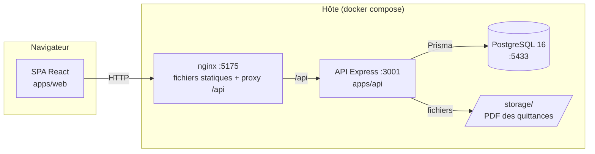
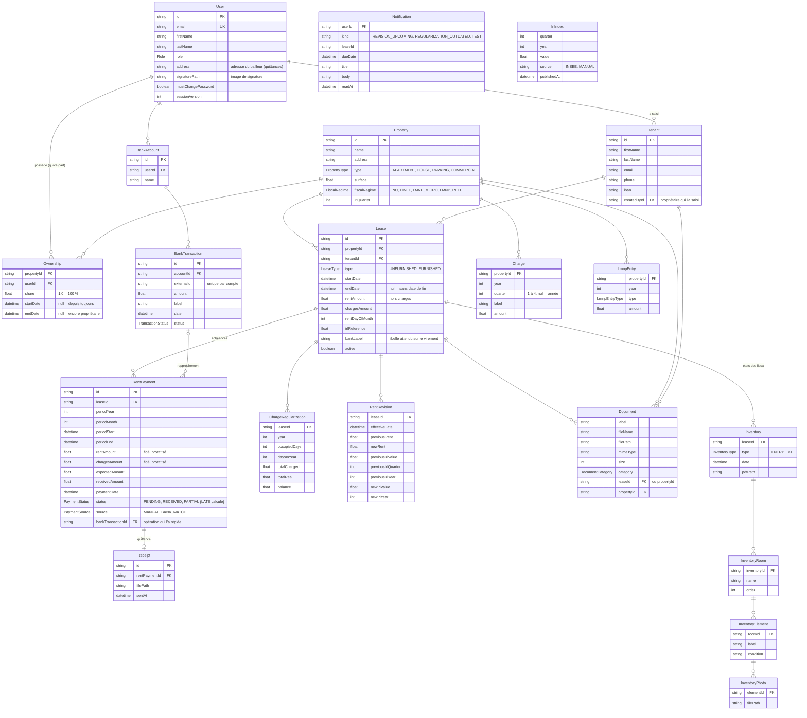

# Dossier d'architecture technique

> Description de l'application telle qu'elle est **aujourd'hui** : composants, API, modèle de données, règles métier, tests et déploiement.
> On le met à jour à chaque changement de structure (nouvelle migration, nouvelle route, nouveau composant transverse).
> L'avancement et les décisions au jour le jour sont dans [AVANCEMENT.md](AVANCEMENT.md).
>
> Dernière mise à jour : 2026-11-21 (multipropriétaires : connexion, données par propriétaire, copropriété, signatures).

## 1. Vue d'ensemble

Application web de gestion locative pour des biens détenus en propre (un ou plusieurs propriétaires par bien). Elle est
pensée pour un usage personnel, auto-hébergé sur une machine du réseau local.



- En développement, Vite (port 5175) remplace nginx et proxifie `/api` vers `API_URL` (par défaut `http://localhost:3001`).
- Tous les ports sont liés à `127.0.0.1`. Toutes les routes `/api` (sauf la connexion) exigent une session : voir § 3.3.

## 2. Pile technique

| Couche | Technologies |
|---|---|
| Front (`apps/web`) | React 18, Vite 5, TypeScript, Tailwind 3, React Router 6, TanStack Query 5, icônes `lucide-react` |
| API (`apps/api`) | Node 22, Express 4, TypeScript (commonjs), zod (validation), winston (logs), pdfkit (quittances) |
| Données | PostgreSQL 16, Prisma 5 (schéma et migrations dans `apps/api/prisma`) |
| Tests | Vitest partout ; Supertest + vraie base `_test` pour l'API ; Testing Library + jsdom pour le front |
| Livraison | Docker (une image par app), docker compose, CI GitHub Actions, images sur GHCR |

## 3. API

### 3.1 Organisation en couches

```
routes/        validation zod (middleware validate) et association URL → contrôleur
controllers/   lecture de la requête HTTP, code de retour
services/      règles métier (prorata, statuts, quittances…), erreurs AppError(status, message)
repositories/  accès aux données Prisma (requêtes, include)
lib/           prisma, période et prorata (period.ts), PDF (receiptPdf.ts), stockage (storage.ts), DEV_USER_ID
middlewares/   validate, errorHandler (AppError → JSON { error }, zod → 400 avec le détail des champs),
               auth (requireAuth, requireAdmin, currentUser)
```

`src/app.ts` construit l'application Express (importée par les tests). `src/index.ts` ne fait que l'écoute du port.

### 3.2 Routes

| Méthode et chemin | Rôle |
|---|---|
| `GET /health` | Santé du service (public) |
| `POST /api/auth/login`, `POST /api/auth/logout` | Connexion (cookie de session) et déconnexion (publiques) |
| `GET/POST /api/properties`, `GET/PATCH/DELETE /api/properties/:id` | Biens (filtrés par propriétaire via `Ownership`) |
| `GET/POST /api/tenants`, `GET/PATCH/DELETE /api/tenants/:id` | Locataires |
| `GET/POST /api/leases`, `GET/PATCH /api/leases/:id`, `GET /api/leases/property/:propertyId`, `POST /api/leases/:id/terminate` | Baux |
| `GET /api/rent-payments?year&month&leaseId` | Échéances (avec bail, bien, locataire, quittance) |
| `POST /api/rent-payments/generate {year, month}` | Génère les échéances du mois (idempotent) |
| `PUT /api/rent-payments/:id/payment`, `DELETE /api/rent-payments/:id/payment` | Saisit ou annule un encaissement |
| `DELETE /api/rent-payments/:id` | Supprime une échéance non payée |
| `POST /api/rent-payments/:id/receipt`, `GET /api/rent-payments/:id/receipt[?download]` | Génère ou télécharge la quittance PDF |
| `GET/PATCH /api/me` | Profil et adresse du bailleur (avec `role`, `mustChangePassword`, `hasSignature`) ; `email` modifiable (minuscules, 409 si déjà pris), il sert d'identifiant et d'adresse des notifications |
| `PUT /api/me/password` | Change son mot de passe (ferme les autres sessions) |
| `GET/PUT/DELETE /api/me/signature` | Image de sa signature (PNG ou JPEG en data URL, 300 Ko au plus) |
| `GET /api/users` | Annuaire (id, nom, e-mail) : tous les comptes avec leur `role` pour l'administrateur ; soi et les copropriétaires (actuels ou passés) de ses biens pour un propriétaire (`USER`) |
| `POST /api/users`, `PUT /api/users/:id/password`, `PUT /api/users/:id/role {role}` | Administrateur : crée un compte (rôle `USER` = propriétaire par défaut), réinitialise un mot de passe (provisoire), change le rôle d'un autre compte (pas le sien, 400) |
| `PUT /api/properties/:id/owners` | Copropriétaires du bien et quotes-parts, datées (`startDate`, `endDate` facultatives) |
| `GET /api/irl`, `PUT /api/irl {quarter, year, value}` | Indices IRL (communs à tous les comptes, `source` INSEE ou MANUAL, `publishedAt`) ; PUT crée ou corrige à la main |
| `GET /api/irl/sync`, `POST /api/irl/sync` | Dernière vérification auprès de l'INSEE (null avant la première) ; vérification à la demande : `{checkedAt, added, corrected, latest, error?}` |
| `GET /api/charges?year&propertyId`, `POST /api/charges`, `PATCH/DELETE /api/charges/:id` | Charges récupérables réelles d'un bien pour une année ou un trimestre (`quarter` 1 à 4, null = année) |
| `GET /api/charges/allocation?year` | Répartition des charges de l'année par bien : entre locataires (`tenants` : part réelle au prorata des jours occupés dans la période de chaque charge, provisions, solde, régularisation faite), part de vacance (`vacancy`, reste aux propriétaires), et entre propriétaires successifs (`owners`, quotes-parts datées) ; `regularization.outdated` et `currentBalance` si la régularisation enregistrée est périmée |
| `GET /api/charges/outdated-regularizations` | Régularisations enregistrées qui ne correspondent plus au recalcul (alerte du tableau de bord) : solde enregistré et recalculé |
| `GET /api/notifications`, `POST /api/notifications/:id/read`, `POST …/read-all` | Notifications de l'utilisateur (50 dernières), lecture |
| `GET /api/notifications/upcoming` | Prochains rappels de l'utilisateur : par bail actif, anniversaire, date d'envoi (`remindOn` = anniversaire − délai), état (`planned`, `sent`, `past`, `not_owner`) |
| `POST /api/notifications/check` | Lance tout de suite la recherche des rappels (tous les baux, idempotent) ; renvoie `{ created, upcoming }` |
| `POST /api/notifications/test` | Message d'essai sur tous les canaux ; résultat par canal (`sent`, `disabled`, `not_configured`, `{error}`) |
| `GET /api/documents?leaseId&propertyId&category` | Documents visibles (bail ou bien de l'utilisateur), du plus récent au plus ancien ; avec `propertyId`, ceux du bien **et** de ses baux. Avec `property` et `lease` (bien, locataire), sans le chemin sur le disque |
| `POST /api/documents?leaseId\|propertyId&category&fileName[&label]` | Envoi d'un fichier **brut** dans le corps (`Content-Type` = son type), 15 Mo au plus (413). Exactement un rattachement (400). Types acceptés : PDF, JPEG, PNG, WebP, HEIC, Word, Excel, OpenDocument (415 sinon) ; signature binaire vérifiée (400 si le contenu ne correspond pas) |
| `PATCH /api/documents/:id {label?, category?}`, `DELETE /api/documents/:id` | Renomme ou change le type ; supprime la ligne et le fichier |
| `GET /api/documents/:id/file[?download]` | Le fichier : affiché (PDF, images courantes) ou téléchargé (autres types, ou `?download`), nom accentué (RFC 6266), `nosniff`, `no-store` |
| `GET/POST /api/bank-accounts`, `PATCH/DELETE /api/bank-accounts/:id {name}` | Comptes bancaires de l'utilisateur (`transactionCount`, `toMatchCount` = encaissements à rapprocher, `lastTransactionDate`) ; suppression refusée (409) si une opération est rapprochée |
| `POST /api/bank-accounts/:id/import` | Relevé CSV **brut** dans le corps (5 Mo) : `{imported, duplicates, skipped[{line, reason}], from, to}` ; 422 si le format n'est pas reconnu. Génère au besoin les échéances des mois des encaissements (jusqu'au mois en cours), pour les **baux déjà suivis** seulement et à partir de leur première échéance |
| `GET /api/bank-connection/banks` | Connexion automatique : `{configured, banks[{name, beta}]}` (France, particuliers) ; `configured: false` sans les variables `ENABLE_BANKING_*` |
| `POST /api/bank-accounts/:id/connect {bankName}` | Lance l'accord à la banque (Enable Banking) : `{url}` du site de la banque ; consentement de 180 jours au plus |
| `POST /api/bank-accounts/:id/connect/complete {returnUrl}` | Retour de la banque (adresse recopiée, ou reçue sur `/bank`) : vérifie `state`, ouvre la session ; un seul compte autorisé → relié et synchronisé, sinon `accountChoices` |
| `PUT /api/bank-accounts/:id/connect/account {uid}`, `DELETE /api/bank-accounts/:id/connect` | Choisit le compte de la banque (puis synchronise) ; déconnecte (session révoquée, opérations gardées) |
| `POST /api/bank-accounts/:id/sync` | Relève les opérations du compte relié : `{imported, duplicates, from, to, since}` ; erreur gardée dans `lastSyncError` |
| `GET /api/bank-transactions?accountId&status&direction=credit\|debit&year` | Opérations (récentes d'abord) avec le compte et les échéances rapprochées ; pour un encaissement à rapprocher, `suggestions` (3 au plus : `allocations[{rentPaymentId, amount, payment}]`, `score`, `confidence` high/medium, `reasons`) |
| `POST /api/bank-transactions/:id/match {allocations[{rentPaymentId, amount}]}`, `DELETE …/:id/match` | Rapproche un encaissement d'une ou plusieurs échéances (total ≤ montant, 400) ; défait le rapprochement (échéances en attente, quittances supprimées) |
| `PUT /api/bank-transactions/:id/status {status: IGNORED\|UNMATCHED}` | Ignore une opération ou la remet à rapprocher (409 si rapprochée) |
| `GET /api/leases/:id/revisions`, `GET …/revisions/preview[?date]` | Historique des révisions ; proposition (date, indices, loyer maximum, ce qui manque) |
| `POST /api/leases/:id/revisions {effectiveDate, newRent?}`, `DELETE …/revisions/:rid` | Applique une révision ; annule la dernière |
| `GET /api/leases/:id/revisions/:rid/letter[?download]` | Avis de révision PDF (généré à la volée) |
| `GET /api/leases/:id/regularizations`, `GET …/regularizations/preview?year` | Régularisations enregistrées ; calcul pour une année (`outdated` : l'enregistrée ne correspond plus au calcul) |
| `POST /api/leases/:id/regularizations {year}`, `DELETE …/regularizations/:rid` | Enregistre (une par an) ou supprime une régularisation |
| `GET /api/leases/:id/regularizations/:rid/statement[?download]` | Décompte de régularisation PDF (généré à la volée) |

Codes d'erreur : 400 (validation), 401 (pas connecté), 403 (administrateur requis, ou mot de passe provisoire à changer), 404 (introuvable,
ou appartenant à un autre propriétaire), 409 (conflit métier : bail actif en double, suppression avec historique,
quittance impossible…). Le corps est toujours `{ "error": "message en français" }`.

### 3.3 Authentification et droits

- **Session** : `POST /api/auth/login` vérifie le mot de passe (bcrypt) et pose un cookie `gl_session` (`HttpOnly`,
  `SameSite=Lax`, `Secure` si `COOKIE_SECURE=true`, 30 jours). Le cookie contient l'id de l'utilisateur, une version de
  session et l'expiration, signés en HMAC-SHA256 avec `SESSION_SECRET` (obligatoire en production, 32 caractères minimum).
  Pas de table de sessions. `requireAuth` relit l'utilisateur à chaque requête et compare `User.sessionVersion` : la
  changer (nouveau mot de passe, réinitialisation par l'administrateur) ferme toutes les sessions ouvertes.
- **Comptes** : pas d'inscription libre. L'administrateur crée les comptes avec un mot de passe provisoire
  (`mustChangePassword`) ; tant qu'il n'est pas changé, seules `GET /me`, `PUT /me/password` et la déconnexion répondent (403 sinon).
  Compte bloqué (y compris le dernier administrateur) : `npm run reset-password -- <email>` dans `apps/api`
  (`prisma/reset-password.ts`, base de `DATABASE_URL`) affiche un mot de passe provisoire et ferme les sessions du compte.
- **Échec de connexion** : même message pour un e-mail inconnu et un mauvais mot de passe, avec le même temps de calcul.
- **Droits** : un utilisateur ne voit et ne modifie que les biens dont il est (co)propriétaire, et tout ce qui en
  dépend (baux, échéances, quittances). Les copropriétaires d'un bien ont **tous les mêmes droits**. Un locataire est
  visible par celui qui l'a saisi et par les propriétaires des biens qu'il loue ou a loués (seuls leurs propres baux
  sont renvoyés). Une ressource d'un autre propriétaire répond 404, comme si elle n'existait pas.
- **Rôle ADMIN** : gestion des comptes seulement ; il ne voit pas les biens des autres.

## 4. Modèle de données

Le schéma complet est déjà en base (migration `init`), y compris les tables des phases à venir. Les modèles
**utilisés** par l'application sont en gras dans le tableau du § 4.2.

### 4.1 Diagramme



### 4.2 Tables et état d'utilisation

| Modèle | Rôle | Phase | Utilisé |
|---|---|---|---|
| **User** | Compte de connexion et bailleur (adresse, signature) | socle, 2, multipropriétaires | oui |
| **Ownership** | Lien bien ↔ propriétaire, avec quote-part (copropriété) et période de détention ; une seule période par propriétaire et par bien | socle, 4 bis | oui |
| **Property** | Bien loué | socle | oui |
| **Tenant** | Locataire (`createdById` : qui l'a saisi) | socle | oui |
| **Lease** | Bail : un seul bail actif par bien | socle | oui |
| **RentPayment** | Échéance mensuelle et encaissement. Unique par `(leaseId, periodYear, periodMonth)` | 2 | oui |
| **Receipt** | Quittance PDF d'une échéance payée en entier | 2 | oui |
| BankAccount, BankTransaction | Compte bancaire d'un utilisateur ; opération importée (montant signé : positif = crédit), unique par `(accountId, externalId)`, rapprochée d'une ou plusieurs échéances (`RentPayment.bankTransactionId`) | 3 | oui |
| Charge, ChargeRegularization | Charges réelles par bien, régularisation annuelle par bail (unique par bail et par année) | 4 | oui |
| RentRevision | Historique des révisions IRL d'un bail (valeurs avant/après) | 4 | oui |
| IrlIndex | Indices IRL de l'INSEE, importés chaque jour (ou saisis à la main) | 4, 4 bis | oui |
| Notification | Notification d'un propriétaire (rappel de révision, régularisation à refaire, essai) ; unique par `(userId, kind, leaseId, dueDate)` | 4 bis | oui |
| LmnpEntry | Écritures comptables LMNP | 5 | non |
| Document | Fichiers rattachés à un bail **ou** à un bien (contrainte `Document_owner_check`), dans `storage/documents/` ; `tenantId` prévu pour le dossier locataire, pas encore utilisé | US-04 | oui |
| Inventory, InventoryRoom, InventoryElement, InventoryPhoto | États des lieux d'entrée et de sortie | US-22 à 25 | non |

### 4.3 Écarts connus avec la maquette du front

La maquette (`GestionLocative.jsx`, voir AVANCEMENT.md) montre des notions qui **n'existent pas encore** dans le schéma.
Il faudra une migration au moment de faire l'écran concerné :
- **Interventions** (plomberie, sinistre, artisan, coût…) : aucun modèle.
- **Régimes fiscaux** : la maquette propose aussi Location nue, LMNP tourisme classé, Denormandie et Loc'Avantages (l'enum `FiscalRegime` n'a que NU, PINEL, LMNP_MICRO, LMNP_REEL).
- **Types de bien** : Studio, Garage, Maison… et l'option « borne de recharge » d'un parking.
- **Plusieurs locataires sur un bail** (colocation) : aujourd'hui `Lease.tenantId` est unique.
- **Plusieurs bailleurs** : fait (copropriété avec quote-part, voir § 3.3 et § 5).
- **Dossier locataire** (pièces obligatoires) : à rapprocher de `Document` (`tenantId`, catégories à ajouter).

## 5. Règles métier implémentées

- **Bail** : un seul bail actif par bien (409 sinon). La résiliation fixe `endDate` (qui ne peut pas précéder le début du
  bail : 400) et passe `active` à `false`. Modifier le loyer ou les charges ne change pas les échéances déjà générées. Un bien
  ou un locataire qui a un historique de baux ne peut pas être supprimé (409).
- **Génération des échéances** (`POST /generate`) : un bail donne une échéance pour un mois s'il en couvre au moins un jour
  (commencé avant la fin du mois, et soit sans date de fin et actif, soit avec une date de fin dans le mois ou après).
  Le front reprend cette règle telle quelle (`coversMonth` dans `Dashboard.tsx`) pour l'alerte « échéances à générer ».
- **Prorata** au jour si le bail commence ou finit dans le mois (date de fin incluse). Loyer et charges sont arrondis
  séparément ; le montant attendu est leur somme. Les montants sont figés à la génération.
- **Statuts** : `PENDING`, `PARTIAL` ou `RECEIVED` sont stockés. `LATE` est **calculé à la lecture** (échéance passée et
  `PENDING`). L'échéance tombe le `rentDayOfMonth` du bail, ou au début de la période si elle commence plus tard.
- **Quittance** : seulement pour un loyer payé en entier, avec l'adresse de chaque propriétaire renseignée. Tous les
  copropriétaires y figurent comme bailleurs, chacun avec sa signature (image) s'il en a enregistré une, sinon un espace
  pour signer à la main. PDF dans `STORAGE_PATH/pdfs/quittances/<année>/<id>.pdf`, signatures dans
  `STORAGE_PATH/signatures/<userId>.png|jpg`. Modifier ou annuler le paiement supprime la quittance ; changer de
  signature ne modifie pas les quittances déjà établies.
- **Copropriété** : `PUT /properties/:id/owners` remplace la liste complète ; quotes-parts > 0 dont la somme vaut
  100 % ; on ne peut pas se retirer soi-même. Un nouveau bien appartient à 100 % à son créateur.
- **Révision IRL** (art. 17-1 de la loi de 1989) : une fois par an au plus, à partir de l'anniversaire du bail (ou de
  la dernière révision). Indice retenu : le plus récent du trimestre de référence **publié à la date d'effet**
  (publication INSEE estimée au 15 du mois qui suit le trimestre, `lastPublishedYear`). Loyer maximum =
  loyer × nouvel IRL / IRL de référence, arrondi au centime ; on peut appliquer moins. Le bail prend le nouveau loyer
  et le nouvel IRL de référence. Le loyer d'une période se calcule jour par jour d'après l'historique (`rentAt`) : une
  révision en cours de mois est proratisée. Les échéances non payées touchées sont recalculées (aussi à l'annulation,
  possible pour la dernière révision seulement).
- **Régularisation des charges** (art. 23) : part du locataire = somme, pour chaque charge, de montant × jours occupés
  dans la période de la charge (trimestre ou année) / jours de la période (la vacance reste au bailleur) ; moins les provisions des échéances générées de l'année (les mois
  sans échéance sont signalés) ; solde > 0 à réclamer, < 0 à rembourser. Une régularisation par bail et par année ; on
  la supprime pour la refaire. Provision mensuelle suggérée = charges de l'année / 12.
  Une régularisation est **périmée** quand le recalcul ne redonne pas ses jours d'occupation, sa part réelle ou ses
  provisions (charge ajoutée, modifiée ou supprimée après coup, échéance ou bail modifiés) : alerte sur le tableau de
  bord, badge sur la page Charges, bandeau avec « Mettre à jour » (suppression puis nouvel enregistrement) dans le bail.
- **Courriers PDF** (avis de révision, décompte) : générés à la volée, non stockés, avec les bailleurs et leurs
  signatures comme la quittance (`services/landlords.ts`, `lib/pdfCommon.ts`).
- **Quotes-parts datées** (`lib/ownership.ts`) : un propriétaire possède le bien de `startDate` à `endDate` incluses
  (null = sans limite). `checkTimeline` impose qu'à chaque date où le bien est détenu la somme fasse 100 % (pas de trou,
  pas de chevauchement), et au moins un propriétaire actuel. Un ancien propriétaire garde l'accès au bien (historique).
  Les courriers prennent les propriétaires à leur date : quittance au début de la période, avis de révision à la date
  d'effet, décompte de régularisation au jour de l'édition.
- **Répartition des charges entre propriétaires** : pour chaque charge, quote-part × jours détenus dans sa période /
  jours de la période (`allocate`). D'où l'intérêt de saisir les charges par trimestre quand le bien change de mains.
- **Rappels de révision** (`services/notifications.ts`) : tâche lancée au démarrage de l'API puis toutes les 6 heures
  (`NOTIFICATIONS=off` pour la couper). Pour chaque bail actif dont l'anniversaire (ou celui de la dernière révision)
  est à venir dans le délai de chaque propriétaire (`User.notifyDaysBefore`, 60 jours par défaut), une notification
  par propriétaire **à la date anniversaire**, avec le loyer révisé maximum (ou l'indice manquant) et sa quote-part.
  Une seule par bail, propriétaire et anniversaire. Envoyée aussi par e-mail (si `SMTP_HOST` est configuré et
  `notifyEmail`), sur ntfy (`ntfyTopic`) et par SMS Free Mobile (`freeMobileUser`/`freeMobileKey`, clé jamais renvoyée
  par l'API) ; un échec d'envoi est journalisé sans bloquer (`lib/notifiers.ts`).
- **Régularisation à refaire, cloche** (`checkRegularizations`, `services/charges.ts`) : après chaque ajout, modification
  ou suppression d'une charge, chaque régularisation de l'année du bien est recalculée ; si elle est périmée, une
  notification `REGULARIZATION_OUTDATED` (`dueDate` = 1er janvier de l'année) à chaque propriétaire actuel, une seule
  fois ; retirée quand la régularisation est refaite, supprimée ou redevenue juste. Cloche seulement (pas d'e-mail).
  Exemple en base : `npm run demo:regularisation` (bien « Démo régularisation », sans toucher au reste).
- **Import des IRL** (`services/irl.ts`, `lib/insee.ts`) : série 001515333 de la BDM de l'INSEE (SDMX, accès libre,
  sans clé), 40 derniers trimestres, au démarrage de l'API puis chaque jour (`IRL_SYNC=off` pour couper). Ajoute les
  trimestres manquants et remplace une valeur saisie à la main par la valeur officielle ; un échec est rendu, pas levé.
- **Rôles** : `ADMIN` (voit et gère tous les comptes, dans Paramètres) et `USER` = propriétaire (ne voit que ses biens
  et ses copropriétaires). Les droits sur un bien sont les mêmes pour tous ses propriétaires, quel que soit le rôle.
- **Documents** (`services/documents.ts`) : rattachés à un bail ou à un bien, visibles par tous les propriétaires du
  bien. Catégories de la maquette (contrat, états des lieux, assurance, photos) et d'un bien (diagnostics, titre de
  propriété, taxe foncière, factures). Le type annoncé doit être dans la liste et correspondre à la signature du
  fichier ; le fichier est rangé sous un nom aléatoire (`documents/<uuid>.<ext>`), le nom d'origine sert au
  téléchargement. La suppression d'un bien (sans bail) supprime ses documents ; un bail ne se supprime pas.
  Exemple en base : `npm run demo:paiements-documents` (bien « Démo paiements » : échéances payées, partielle, en
  retard, et documents fictifs ; `-- --supprimer` pour le retirer). `npm run demo` lance tous les exemples.
- **Rapprochement bancaire** (`services/bank.ts`, `lib/bankCsv.ts`, `lib/bankMatching.ts`) : l'application **propose**,
  l'utilisateur **valide** ; rien n'est rapproché d'office.
  - *Import CSV* : ligne d'en-tête repérée par les noms de colonnes (Date, Libellé…, Montant ou Débit/Crédit), séparateur
    `;`, tabulation ou `,`, virgule décimale, UTF-8 ou Windows-1252, date d'opération plutôt que de valeur. Identifiant
    de l'opération = empreinte (date, montant, libellé, rang parmi les lignes identiques du fichier) : réimporter un
    relevé qui chevauche le précédent ne crée pas de doublon.
  - *Échéances créées par l'import ou la synchronisation* (`rentPaymentsService.generate(…, { trackedOnly })`) : seulement
    pour les baux qui ont déjà une échéance, et pour les mois à partir de la première. Un relevé ancien ne fait donc pas
    apparaître « en retard » des mois jamais suivis ; le suivi d'un bail commence par « Générer le mois » dans Loyers.
  - *Première connexion à la banque* : elle reprend après la dernière opération du compte ; si le compte en contient
    déjà, l'écran de choix de la banque le signale et conseille un compte à part si elles viennent d'ailleurs.
  - *Suggestions* (encaissements seulement, échéances non rapprochées à 75 jours au plus) : montant exact (+50) ou
    partiel (+10) ; libellé de rapprochement du bail (`Lease.bankLabel`, +45) ou à défaut nom du locataire (+30) dans
    le libellé ; échéance à 10 jours au plus (+15), loyer très en avance (−10). Virement groupé : 2 ou 3 échéances
    consécutives d'un bail dont la somme fait le montant. Seuil 40. Confiance « high » (validable en bloc) : montant
    exact, libellé reconnu et échéance à 10 jours au plus. Un trop-perçu n'est proposé que si `bankLabel` concorde.
  - *Rapprochement* : chaque échéance reçoit son montant, la date de l'opération, `source = BANK_MATCH` ; RECEIVED ou
    PARTIAL selon le montant. Un paiement saisi à la main peut être remplacé. Une échéance rapprochée ne se modifie ni ne
    s'annule depuis Loyers (409) : on défait le rapprochement. La quittance est supprimée si le montant ou la date changent.
  - *Connexion automatique* (`lib/enableBanking.ts`, `services/bankConnection.ts`) : agrégateur Enable Banking (mode
    restreint gratuit, comptes reliés dans son portail). Requêtes signées par un JWT RS256 (clé privée hors dépôt,
    `ENABLE_BANKING_KEY_PATH`). Seules les opérations comptabilisées (`BOOK`) sont gardées ; identifiant
    `eb:<entry_reference>` (ou empreinte) ; libellé = émetteur ou bénéficiaire + informations de paiement. Première
    synchronisation : à la suite de la dernière opération du compte (relevé CSV), sinon 90 jours ; ensuite avec
    10 jours de recouvrement. Relevé automatique 30 s après le démarrage puis toutes les 12 h (`BANK_SYNC=off`),
    sauf accord expiré. Les identifiants de session ne sortent pas de l'API (`presentAccount`).
  Exemple en base : `npm run demo:banque` (bien « Démo banque », compte « Démo — compte commun » ; `-- --supprimer`).
- **Dates** : stockées en UTC à minuit. Les calculs de période se font en UTC des deux côtés.

### 5.1 Conséquences prévues de la copropriété (phases suivantes)

- **Impôts** (revenus fonciers, LMNP) : chaque copropriétaire déclare **sa part**. Les revenus encaissés et les charges
  d'un bien seront répartis au prorata de `Ownership.share` dans les écrans et exports fiscaux (un récapitulatif par
  propriétaire et par année). Les quotes-parts sont datées depuis la phase 4 bis : la répartition se fera au jour,
  comme pour les charges (`allocate`).
- **Régime fiscal** : aujourd'hui porté par le bien (`Property.fiscalRegime`), donc commun à tous les copropriétaires.
  Si deux copropriétaires relèvent de régimes différents, il faudra le déplacer sur `Ownership`.
- **Documents et états des lieux** : visibles par tous les copropriétaires du bien (même règle que les baux).
- **Signature électronique** : hors périmètre ; la signature est une simple image apposée sur le PDF.

## 6. Front

```
src/api/client.ts          appels HTTP (fetch), erreurs → Error(message de l'API)
src/lib/format.ts          formatage commun (euros, dates en UTC, durées, libellés des types de bien et régimes fiscaux)
src/hooks/                 un fichier par ressource (TanStack Query : lecture et mutations, invalidation du cache) ;
                           useActionError : exécute une mutation et garde le message d'erreur de l'API pour l'afficher
src/types/index.ts         types des réponses de l'API (tenus à jour avec le test de contrat, § 7)
src/pages/                 un écran par route
src/components/ui/         composants maison repris de la maquette (Card, Modal, Field, StatCard, Badge,
                           PaymentStatusBadge, PropTypeIcon, ErrorAlert…)
src/components/layout/     Sidebar (desktop), MobileHeader et BottomNav avec menu « Plus » (mobile), nav.ts (menu)
src/components/icons.tsx   point d'entrée unique des icônes lucide-react
```

| Route | Écran |
|---|---|
| `/` | Tableau de bord : indicateurs, alertes, suivi mensuel des loyers |
| `/properties` | Biens : type, régime fiscal, propriétaires (lien vers `/owners`), historique des locataires avec périodes de vacance |
| `/owners?property` | Propriétaires : par bien, quotes-parts et dates de détention (statut actuel, ancien, à venir), modification (`components/OwnersModal`) |
| `/indices` | Référentiel des indices IRL : valeur, évolution sur un an, source et date de publication, « Vérifier maintenant », saisie manuelle de secours |
| `/tenants` | Locataires : onglets « En cours » / « Anciens et sans bail », historique des baux |
| `/leases` | Locations (baux) : liste, création |
| `/leases/:id` | Fiche du bail : conditions, modification, résiliation, échéances et quittances du bail |
| `/rents?year&month` | Loyers : génération, encaissements, quittances |
| `/payments` | Paiements : encaissements de l'année (filtre par bien, export CSV), loyers à relancer (retards et partiels) ; lit `GET /api/rent-payments?year` |
| `/bank` | Synchro bancaire : comptes (import d'un relevé CSV, renommage, suppression, connexion à la banque — `components/bank/BankConnection` : choix de la banque par recherche, adresse de retour à recopier, choix du compte, état, synchronisation, expiration de l'accord), onglets À rapprocher (suggestions à valider, « Tout valider » pour les correspondances sûres, choix manuel des échéances et des montants, Ignorer), Rapprochés (Défaire), Ignorés, Débits |
| `/documents`, `?property=`, `?lease=` | Documents : tuiles des biens et des baux (en cours, terminés) avec le nombre de documents ; dossier d'un bien ou d'un bail : documents rangés par type, filtre par boutons, ajout rattaché (type choisi par boutons), ouverture, téléchargement, renommage, suppression ; dans un bien, tuiles de ses baux. Lien « Documents » sur chaque bien, bloc « Documents du bail » sur la fiche du bail |
| `/charges?year` | Charges récupérables par bien, par année ou par trimestre, répartition entre propriétaires successifs, liens vers la régularisation de chaque bail |
| `/notifications` | Notifications (rappels de révision), avec le bloc « Prochains rappels » et le bouton « Vérifier maintenant » ; cloche avec le nombre de non lues dans la barre latérale et l'en-tête mobile |
| `/settings` | Paramètres : identité et adresse, signature, mot de passe, notifications (délai, e-mail, ntfy, SMS Free Mobile, essai), comptes et rôles (administrateur) |

**Connexion** : `components/auth/AuthGate` n'affiche l'application qu'à un utilisateur connecté ; sinon l'écran de
connexion, ou le changement obligatoire du mot de passe provisoire. Une 401 pendant l'utilisation (session expirée)
recharge le profil et ramène à la connexion. La déconnexion vide le cache des données. Les copropriétaires d'un bien se
gèrent dans la page Propriétaires (`pages/Owners`, fenêtre `components/OwnersModal`).

Toutes les erreurs de l'API (400, 404, 409) s'affichent à l'écran (`ErrorAlert`) : en haut de la page pour une
action de liste, dans la fenêtre pour un formulaire (qui reste alors ouvert).

Le menu (`components/layout/nav.ts`) suit les groupes de la maquette : Tableau de bord / Patrimoine / Finances
(puis Gestion). Les écrans des phases suivantes y seront ajoutés au fur et à mesure.

## 7. Stratégie de tests

| Niveau | Où | Ce qui est vérifié |
|---|---|---|
| Droits et sessions | `apps/api/tests/auth.test.ts`, `multiOwner.test.ts`, `signature.test.ts` | Connexion, cookie falsifié ou expiré, sessions fermées au changement de mot de passe, compte provisoire, isolation entre propriétaires (404 en lecture et en écriture), copropriété, locataire commun, signatures dans le PDF |
| Intégration API | `apps/api/tests/*.test.ts` | Chaque route via HTTP (Supertest) sur une vraie base PostgreSQL `<base>_test`, vidée avant chaque test : validation, codes d'erreur, règles métier, PDF |
| **Contrat API ↔ front** | `apps/api/tests/frontContract.test.ts` | Les champs et relations que lisent les écrans (et que simulent les tests du front) sont bien renvoyés par l'API, avec `null` plutôt qu'absent |
| Composants et écrans | `apps/web/src/**/*.test.tsx` | Rendu et interactions, avec `fetch` simulé (`src/test/utils.tsx` : `mockApi` par chemin ou « MÉTHODE chemin », `reply(status, corps)` pour simuler une erreur), y compris l'affichage des erreurs de l'API et le contenu des requêtes envoyées |
| Règles partagées | `Dashboard.test.tsx` (`coversMonth`) | Cas limites identiques à ceux de l'API (début et fin de bail, bail résilié) |

Les tests du front utilisent des données simulées : si l'API change de forme, ils continuent de passer. Le **test de
contrat** côté API sert de garde-fou : quand il casse, on met à jour en même temps `src/types` et les données simulées
du front.

`npm run verify` (à la racine) lance la compilation et les tests des deux apps. La CI fait la même chose.

## 8. Déploiement et environnements

| Environnement | Lancement | Accès |
|---|---|---|
| Dev local | `docker compose up -d db`, puis `npm run dev` dans `apps/api` (3001) et `apps/web` (5175) | `http://localhost:5175` |
| Dev à distance | API sur 3002, Vite sur 5176 lié à l'IP Tailscale (voir AVANCEMENT.md) | `http://<IP_TAILSCALE>:5176` (réseau Tailscale) |
| Conteneurs | `docker compose up -d --build` (`db`, `api`, `web`) | `http://localhost:5175` (nginx) |

- **CI** (`.github/workflows/ci.yml`) : compilation et tests des deux apps (service PostgreSQL), puis images Docker.
  Sur `main` ou un tag `v*`, publication sur GHCR : `ghcr.io/asthom8-collab/gestion-locative-{api,web}:{latest,sha-xxxxxxx,X.Y.Z}`.
- **Secrets** : `.env` à la racine (ignoré par git), modèles dans `apps/*/.env.example`. `SESSION_SECRET` y est
  obligatoire pour le conteneur `api` (`openssl rand -hex 32`). Notifications : `APP_URL` (liens absolus dans les
  e-mails et sur le téléphone) et `SMTP_HOST/PORT/USER/PASS/FROM` (sans `SMTP_HOST`, pas d'e-mail ; `SMTP_PORT` vide : 465), facultatives, passées au conteneur `api` par `docker-compose.yml`.
- **Fichiers** : `storage/` (quittances, signatures, documents) n'est jamais commité ; dans les conteneurs, volume
  `app_storage`. nginx accepte des corps jusqu'à 16 Mo sur `/api` (envoi de documents).

## 9. Sécurité et points ouverts

- Connexion et droits par propriétaire en place. Avant une exposition sur Internet, il reste : HTTPS (puis
  `COOKIE_SECURE=true`), limitation des tentatives de connexion, et en-têtes de sécurité (nginx).
- Pas de service worker : le navigateur ne garde pas de vieille version de l'application en cache hors ligne.
