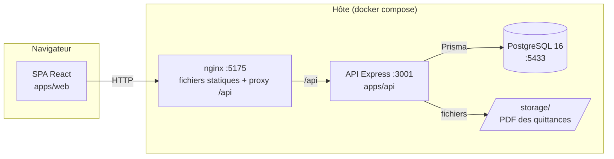
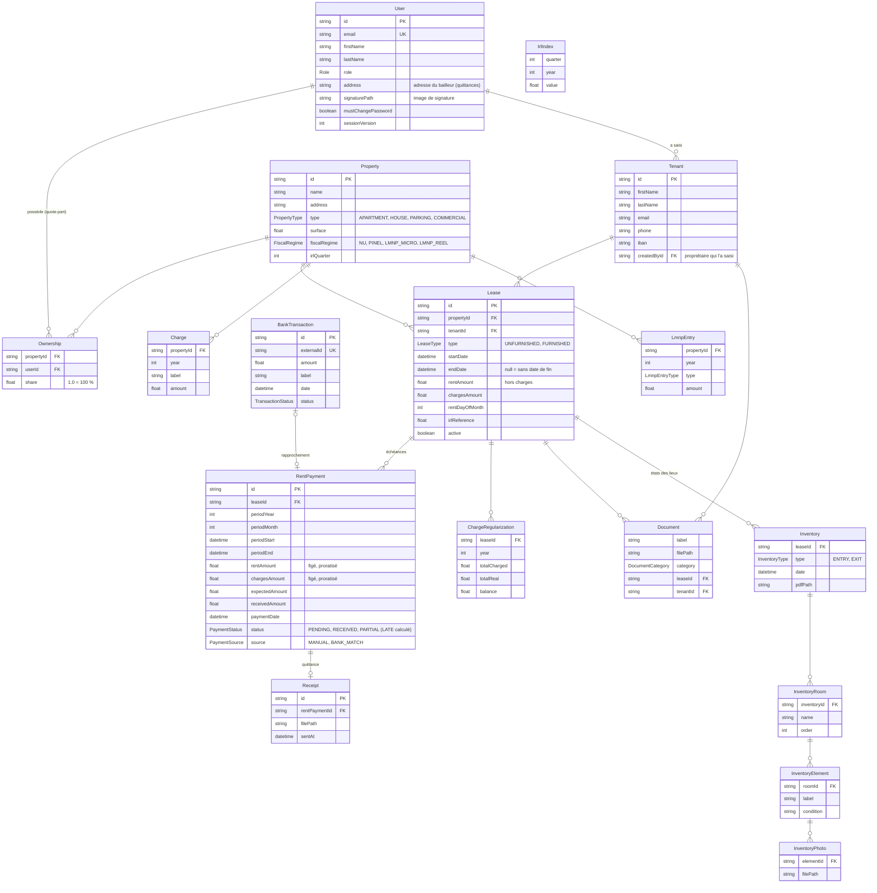

# Dossier d'architecture technique

> Description de l'application telle qu'elle est **aujourd'hui** : composants, API, modèle de données, règles métier, tests et déploiement.
> On le met à jour à chaque changement de structure (nouvelle migration, nouvelle route, nouveau composant transverse).
> L'avancement et les décisions au jour le jour sont dans [AVANCEMENT.md](AVANCEMENT.md).
>
> Dernière mise à jour : 2026-11-21 (multipropriétaires : connexion, données par propriétaire, copropriété, signatures).

## 1. Vue d'ensemble

Application web de gestion locative pour des biens détenus en propre (un ou plusieurs propriétaires par bien). Elle est
pensée pour un usage personnel, auto-hébergé sur une machine du réseau local.



- En développement, Vite (port 5175) remplace nginx et proxifie `/api` vers `API_URL` (par défaut `http://localhost:3001`).
- Tous les ports sont liés à `127.0.0.1`. Toutes les routes `/api` (sauf la connexion) exigent une session : voir § 3.3.

## 2. Pile technique

| Couche | Technologies |
|---|---|
| Front (`apps/web`) | React 18, Vite 5, TypeScript, Tailwind 3, React Router 6, TanStack Query 5, icônes `lucide-react` |
| API (`apps/api`) | Node 22, Express 4, TypeScript (commonjs), zod (validation), winston (logs), pdfkit (quittances) |
| Données | PostgreSQL 16, Prisma 5 (schéma et migrations dans `apps/api/prisma`) |
| Tests | Vitest partout ; Supertest + vraie base `_test` pour l'API ; Testing Library + jsdom pour le front |
| Livraison | Docker (une image par app), docker compose, CI GitHub Actions, images sur GHCR |

## 3. API

### 3.1 Organisation en couches

```
routes/        validation zod (middleware validate) et association URL → contrôleur
controllers/   lecture de la requête HTTP, code de retour
services/      règles métier (prorata, statuts, quittances…), erreurs AppError(status, message)
repositories/  accès aux données Prisma (requêtes, include)
lib/           prisma, période et prorata (period.ts), PDF (receiptPdf.ts), stockage (storage.ts), DEV_USER_ID
middlewares/   validate, errorHandler (AppError → JSON { error }, zod → 400 avec le détail des champs),
               auth (requireAuth, requireAdmin, currentUser)
```

`src/app.ts` construit l'application Express (importée par les tests). `src/index.ts` ne fait que l'écoute du port.

### 3.2 Routes

| Méthode et chemin | Rôle |
|---|---|
| `GET /health` | Santé du service (public) |
| `POST /api/auth/login`, `POST /api/auth/logout` | Connexion (cookie de session) et déconnexion (publiques) |
| `GET/POST /api/properties`, `GET/PATCH/DELETE /api/properties/:id` | Biens (filtrés par propriétaire via `Ownership`) |
| `GET/POST /api/tenants`, `GET/PATCH/DELETE /api/tenants/:id` | Locataires |
| `GET/POST /api/leases`, `GET/PATCH /api/leases/:id`, `GET /api/leases/property/:propertyId`, `POST /api/leases/:id/terminate` | Baux |
| `GET /api/rent-payments?year&month&leaseId` | Échéances (avec bail, bien, locataire, quittance) |
| `POST /api/rent-payments/generate {year, month}` | Génère les échéances du mois (idempotent) |
| `PUT /api/rent-payments/:id/payment`, `DELETE /api/rent-payments/:id/payment` | Saisit ou annule un encaissement |
| `DELETE /api/rent-payments/:id` | Supprime une échéance non payée |
| `POST /api/rent-payments/:id/receipt`, `GET /api/rent-payments/:id/receipt[?download]` | Génère ou télécharge la quittance PDF |
| `GET/PATCH /api/me` | Profil et adresse du bailleur (avec `role`, `mustChangePassword`, `hasSignature`) |
| `PUT /api/me/password` | Change son mot de passe (ferme les autres sessions) |
| `GET/PUT/DELETE /api/me/signature` | Image de sa signature (PNG ou JPEG en data URL, 300 Ko au plus) |
| `GET /api/users` | Annuaire (id, nom, e-mail) pour choisir les copropriétaires |
| `POST /api/users`, `PUT /api/users/:id/password` | Administrateur : crée un compte, réinitialise un mot de passe (provisoire) |
| `PUT /api/properties/:id/owners` | Copropriétaires du bien et quotes-parts |

Codes d'erreur : 400 (validation), 401 (pas connecté), 403 (administrateur requis, ou mot de passe provisoire à changer), 404 (introuvable,
ou appartenant à un autre propriétaire), 409 (conflit métier : bail actif en double, suppression avec historique,
quittance impossible…). Le corps est toujours `{ "error": "message en français" }`.

### 3.3 Authentification et droits

- **Session** : `POST /api/auth/login` vérifie le mot de passe (bcrypt) et pose un cookie `gl_session` (`HttpOnly`,
  `SameSite=Lax`, `Secure` si `COOKIE_SECURE=true`, 30 jours). Le cookie contient l'id de l'utilisateur, une version de
  session et l'expiration, signés en HMAC-SHA256 avec `SESSION_SECRET` (obligatoire en production, 32 caractères minimum).
  Pas de table de sessions. `requireAuth` relit l'utilisateur à chaque requête et compare `User.sessionVersion` : la
  changer (nouveau mot de passe, réinitialisation par l'administrateur) ferme toutes les sessions ouvertes.
- **Comptes** : pas d'inscription libre. L'administrateur crée les comptes avec un mot de passe provisoire
  (`mustChangePassword`) ; tant qu'il n'est pas changé, seules `GET /me`, `PUT /me/password` et la déconnexion répondent (403 sinon).
- **Échec de connexion** : même message pour un e-mail inconnu et un mauvais mot de passe, avec le même temps de calcul.
- **Droits** : un utilisateur ne voit et ne modifie que les biens dont il est (co)propriétaire, et tout ce qui en
  dépend (baux, échéances, quittances). Les copropriétaires d'un bien ont **tous les mêmes droits**. Un locataire est
  visible par celui qui l'a saisi et par les propriétaires des biens qu'il loue ou a loués (seuls leurs propres baux
  sont renvoyés). Une ressource d'un autre propriétaire répond 404, comme si elle n'existait pas.
- **Rôle ADMIN** : gestion des comptes seulement ; il ne voit pas les biens des autres.

## 4. Modèle de données

Le schéma complet est déjà en base (migration `init`), y compris les tables des phases à venir. Les modèles
**utilisés** par l'application sont en gras dans le tableau du § 4.2.

### 4.1 Diagramme



### 4.2 Tables et état d'utilisation

| Modèle | Rôle | Phase | Utilisé |
|---|---|---|---|
| **User** | Compte de connexion et bailleur (adresse, signature) | socle, 2, multipropriétaires | oui |
| **Ownership** | Lien bien ↔ propriétaire, avec quote-part (copropriété) | socle | oui |
| **Property** | Bien loué | socle | oui |
| **Tenant** | Locataire (`createdById` : qui l'a saisi) | socle | oui |
| **Lease** | Bail : un seul bail actif par bien | socle | oui |
| **RentPayment** | Échéance mensuelle et encaissement. Unique par `(leaseId, periodYear, periodMonth)` | 2 | oui |
| **Receipt** | Quittance PDF d'une échéance payée en entier | 2 | oui |
| BankTransaction | Opération bancaire importée, rapprochée d'une échéance | 3 | non |
| Charge, ChargeRegularization | Charges réelles par bien, régularisation annuelle par bail | 4 | non |
| IrlIndex | Indices IRL de l'INSEE | 4 | non |
| LmnpEntry | Écritures comptables LMNP | 5 | non |
| Document | Pièces jointes (bail, locataire) | US-04 | non |
| Inventory, InventoryRoom, InventoryElement, InventoryPhoto | États des lieux d'entrée et de sortie | US-22 à 25 | non |

### 4.3 Écarts connus avec la maquette du front

La maquette (`GestionLocative.jsx`, voir AVANCEMENT.md) montre des notions qui **n'existent pas encore** dans le schéma.
Il faudra une migration au moment de faire l'écran concerné :
- **Interventions** (plomberie, sinistre, artisan, coût…) : aucun modèle.
- **Régimes fiscaux** : la maquette propose aussi Location nue, LMNP tourisme classé, Denormandie et Loc'Avantages (l'enum `FiscalRegime` n'a que NU, PINEL, LMNP_MICRO, LMNP_REEL).
- **Types de bien** : Studio, Garage, Maison… et l'option « borne de recharge » d'un parking.
- **Plusieurs locataires sur un bail** (colocation) : aujourd'hui `Lease.tenantId` est unique.
- **Plusieurs bailleurs** : fait (copropriété avec quote-part, voir § 3.3 et § 5).
- **Dossier locataire** (pièces obligatoires) : à rapprocher de `Document`.

## 5. Règles métier implémentées

- **Bail** : un seul bail actif par bien (409 sinon). La résiliation fixe `endDate` (qui ne peut pas précéder le début du
  bail : 400) et passe `active` à `false`. Modifier le loyer ou les charges ne change pas les échéances déjà générées. Un bien
  ou un locataire qui a un historique de baux ne peut pas être supprimé (409).
- **Génération des échéances** (`POST /generate`) : un bail donne une échéance pour un mois s'il en couvre au moins un jour
  (commencé avant la fin du mois, et soit sans date de fin et actif, soit avec une date de fin dans le mois ou après).
  Le front reprend cette règle telle quelle (`coversMonth` dans `Dashboard.tsx`) pour l'alerte « échéances à générer ».
- **Prorata** au jour si le bail commence ou finit dans le mois (date de fin incluse). Loyer et charges sont arrondis
  séparément ; le montant attendu est leur somme. Les montants sont figés à la génération.
- **Statuts** : `PENDING`, `PARTIAL` ou `RECEIVED` sont stockés. `LATE` est **calculé à la lecture** (échéance passée et
  `PENDING`). L'échéance tombe le `rentDayOfMonth` du bail, ou au début de la période si elle commence plus tard.
- **Quittance** : seulement pour un loyer payé en entier, avec l'adresse de chaque propriétaire renseignée. Tous les
  copropriétaires y figurent comme bailleurs, chacun avec sa signature (image) s'il en a enregistré une, sinon un espace
  pour signer à la main. PDF dans `STORAGE_PATH/pdfs/quittances/<année>/<id>.pdf`, signatures dans
  `STORAGE_PATH/signatures/<userId>.png|jpg`. Modifier ou annuler le paiement supprime la quittance ; changer de
  signature ne modifie pas les quittances déjà établies.
- **Copropriété** : `PUT /properties/:id/owners` remplace la liste complète ; quotes-parts > 0 dont la somme vaut
  100 % ; on ne peut pas se retirer soi-même. Un nouveau bien appartient à 100 % à son créateur.
- **Dates** : stockées en UTC à minuit. Les calculs de période se font en UTC des deux côtés.

### 5.1 Conséquences prévues de la copropriété (phases suivantes)

- **Impôts** (revenus fonciers, LMNP) : chaque copropriétaire déclare **sa part**. Les revenus encaissés et les charges
  d'un bien seront répartis au prorata de `Ownership.share` dans les écrans et exports fiscaux (un récapitulatif par
  propriétaire et par année). La quote-part étant modifiable, il faudra soit la figer par année fiscale (historique
  des quotes-parts), soit l'appliquer telle qu'elle est au moment de l'export : décision à prendre en phase 5.
- **Régime fiscal** : aujourd'hui porté par le bien (`Property.fiscalRegime`), donc commun à tous les copropriétaires.
  Si deux copropriétaires relèvent de régimes différents, il faudra le déplacer sur `Ownership`.
- **Documents et états des lieux** : visibles par tous les copropriétaires du bien (même règle que les baux).
- **Signature électronique** : hors périmètre ; la signature est une simple image apposée sur le PDF.

## 6. Front

```
src/api/client.ts          appels HTTP (fetch), erreurs → Error(message de l'API)
src/lib/format.ts          formatage commun (euros, dates en UTC, durées, libellés des types de bien et régimes fiscaux)
src/hooks/                 un fichier par ressource (TanStack Query : lecture et mutations, invalidation du cache) ;
                           useActionError : exécute une mutation et garde le message d'erreur de l'API pour l'afficher
src/types/index.ts         types des réponses de l'API (tenus à jour avec le test de contrat, § 7)
src/pages/                 un écran par route
src/components/ui/         composants maison repris de la maquette (Card, Modal, Field, StatCard, Badge,
                           PaymentStatusBadge, PropTypeIcon, ErrorAlert…)
src/components/layout/     Sidebar (desktop), MobileHeader et BottomNav avec menu « Plus » (mobile), nav.ts (menu)
src/components/icons.tsx   point d'entrée unique des icônes lucide-react
```

| Route | Écran |
|---|---|
| `/` | Tableau de bord : indicateurs, alertes, suivi mensuel des loyers |
| `/properties` | Biens : type, régime fiscal, propriétaires, historique des locataires avec périodes de vacance |
| `/tenants` | Locataires : onglets « En cours » / « Anciens et sans bail », historique des baux |
| `/leases` | Locations (baux) : liste, création |
| `/leases/:id` | Fiche du bail : conditions, modification, résiliation, échéances et quittances du bail |
| `/rents?year&month` | Loyers : génération, encaissements, quittances |
| `/settings` | Paramètres : identité et adresse, signature, mot de passe, comptes (administrateur) |

**Connexion** : `components/auth/AuthGate` n'affiche l'application qu'à un utilisateur connecté ; sinon l'écran de
connexion, ou le changement obligatoire du mot de passe provisoire. Une 401 pendant l'utilisation (session expirée)
recharge le profil et ramène à la connexion. La déconnexion vide le cache des données. Les copropriétaires d'un bien se
gèrent depuis sa carte (`components/OwnersModal`).

Toutes les erreurs de l'API (400, 404, 409) s'affichent à l'écran (`ErrorAlert`) : en haut de la page pour une
action de liste, dans la fenêtre pour un formulaire (qui reste alors ouvert).

Le menu (`components/layout/nav.ts`) suit les groupes de la maquette : Tableau de bord / Patrimoine / Finances
(puis Gestion). Les écrans des phases suivantes y seront ajoutés au fur et à mesure.

## 7. Stratégie de tests

| Niveau | Où | Ce qui est vérifié |
|---|---|---|
| Droits et sessions | `apps/api/tests/auth.test.ts`, `multiOwner.test.ts`, `signature.test.ts` | Connexion, cookie falsifié ou expiré, sessions fermées au changement de mot de passe, compte provisoire, isolation entre propriétaires (404 en lecture et en écriture), copropriété, locataire commun, signatures dans le PDF |
| Intégration API | `apps/api/tests/*.test.ts` | Chaque route via HTTP (Supertest) sur une vraie base PostgreSQL `<base>_test`, vidée avant chaque test : validation, codes d'erreur, règles métier, PDF |
| **Contrat API ↔ front** | `apps/api/tests/frontContract.test.ts` | Les champs et relations que lisent les écrans (et que simulent les tests du front) sont bien renvoyés par l'API, avec `null` plutôt qu'absent |
| Composants et écrans | `apps/web/src/**/*.test.tsx` | Rendu et interactions, avec `fetch` simulé (`src/test/utils.tsx` : `mockApi` par chemin ou « MÉTHODE chemin », `reply(status, corps)` pour simuler une erreur), y compris l'affichage des erreurs de l'API et le contenu des requêtes envoyées |
| Règles partagées | `Dashboard.test.tsx` (`coversMonth`) | Cas limites identiques à ceux de l'API (début et fin de bail, bail résilié) |

Les tests du front utilisent des données simulées : si l'API change de forme, ils continuent de passer. Le **test de
contrat** côté API sert de garde-fou : quand il casse, on met à jour en même temps `src/types` et les données simulées
du front.

`npm run verify` (à la racine) lance la compilation et les tests des deux apps. La CI fait la même chose.

## 8. Déploiement et environnements

| Environnement | Lancement | Accès |
|---|---|---|
| Dev local | `docker compose up -d db`, puis `npm run dev` dans `apps/api` (3001) et `apps/web` (5175) | `http://localhost:5175` |
| Dev à distance | API sur 3002, Vite sur 5176 lié à l'IP Tailscale (voir AVANCEMENT.md) | `http://<IP_TAILSCALE>:5176` (réseau Tailscale) |
| Conteneurs | `docker compose up -d --build` (`db`, `api`, `web`) | `http://localhost:5175` (nginx) |

- **CI** (`.github/workflows/ci.yml`) : compilation et tests des deux apps (service PostgreSQL), puis images Docker.
  Sur `main` ou un tag `v*`, publication sur GHCR : `ghcr.io/asthom8-collab/gestion-locative-{api,web}:{latest,sha-xxxxxxx,X.Y.Z}`.
- **Secrets** : `.env` à la racine (ignoré par git), modèles dans `apps/*/.env.example`. `SESSION_SECRET` y est
  obligatoire pour le conteneur `api` (`openssl rand -hex 32`).
- **Fichiers** : `storage/` (PDF, futurs documents des locataires) n'est jamais commité.

## 9. Sécurité et points ouverts

- Connexion et droits par propriétaire en place. Avant une exposition sur Internet, il reste : HTTPS (puis
  `COOKIE_SECURE=true`), limitation des tentatives de connexion, et en-têtes de sécurité (nginx).
- Pas de service worker : le navigateur ne garde pas de vieille version de l'application en cache hors ligne.
